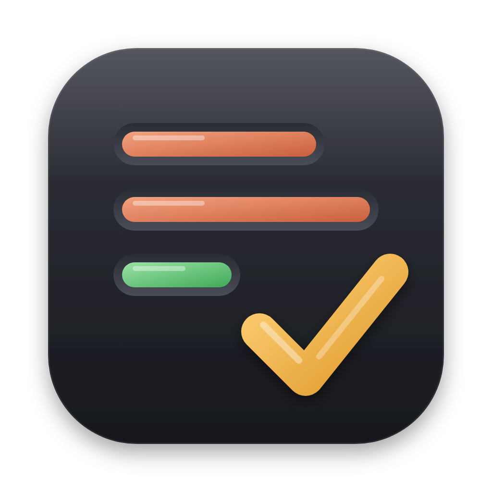
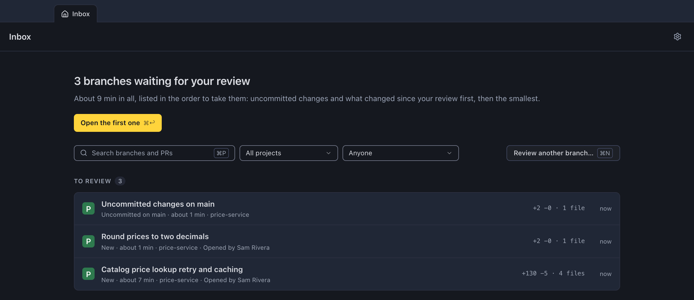
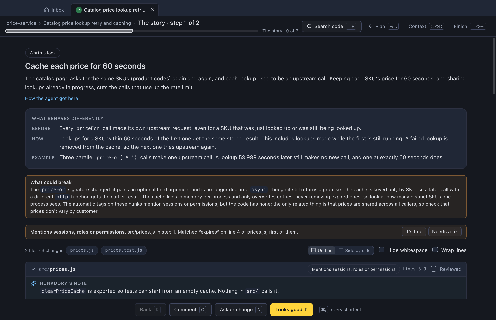
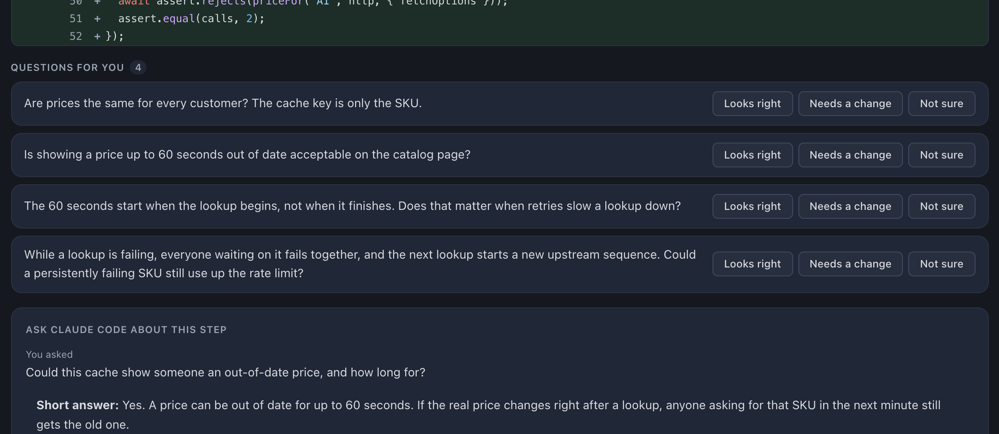
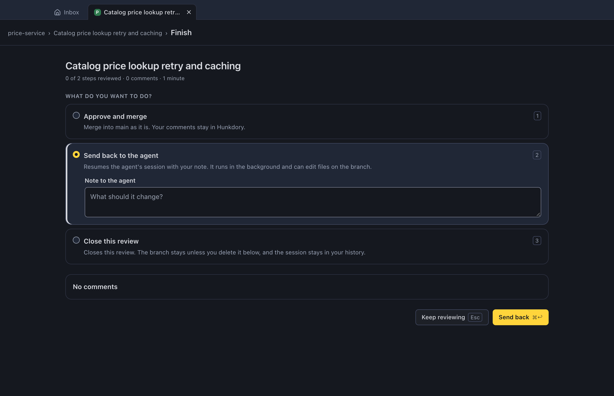
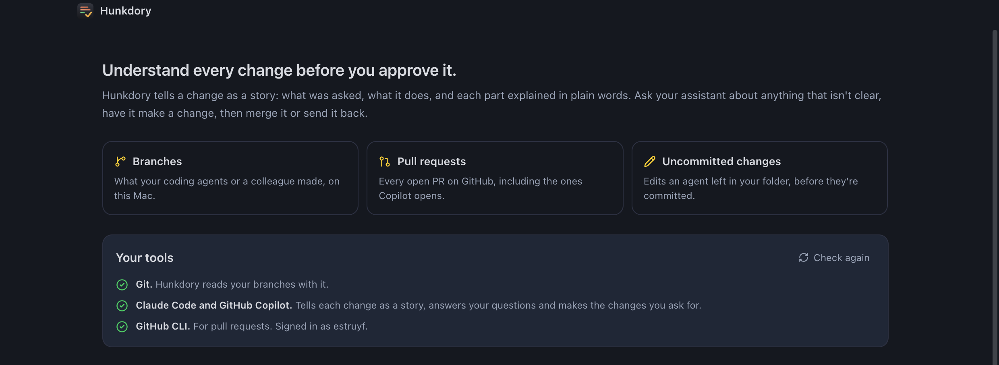

<p align="center">
  
</p>

<h1 align="center">Hunkdory</h1>

<h2 align="center">Understand every change before you approve it.</h2>

<p align="center">
  A Mac and Windows app that tells a branch or pull request as a story, so you can review code you didn't write.<br>
  Made for the code your coding agents hand you.
</p>

<p align="center">
  <a href="https://visitorbadge.io/status?path=https%3A%2F%2Fgithub.com%2Festruyf%2Fhunkdory"></a>
</p>

<p align="center">
  
</p>

## Why Hunkdory

Reviewing code you didn't write is hard, and harder when an agent wrote 20 files of it in ten minutes. A diff shows you what changed, in file order. It doesn't tell you why, or where to start.

Hunkdory gives you that first:

- **What it does.** A sentence or two in plain words, next to what was asked.
- **A story to follow.** The change split into steps in reading order, each explaining one part.
- **Someone to ask.** Ask your assistant about any step, or have it make a change right there.
- **Nothing hidden.** Every changed line is in some step, and work nobody asked for is called out.

Then you merge it, post your review on GitHub, or send it back to the agent with your comments.

## How it works

### 1. Everything waiting for you, in one inbox

Local branches, open pull requests (Copilot's too) and uncommitted changes show up on their own, across all your projects.



### 2. Read the story

Each step says why the change is there, what behaves differently, and what could break, right above the code it's about.



### 3. Ask about anything that isn't clear

Your assistant answers from the code, and from the agent's own session when there is one. Ask it to change something and it does that too.



### 4. Decide

Merge, open or review a pull request, send it back to the agent, or close the review. If the branch changed since you last looked, Hunkdory stops and shows you what's new first.



## Get started

[Download the latest version](https://github.com/estruyf/hunkdory/releases/latest): the `.dmg` for a Mac, or `Hunkdory-<version>-setup.exe` for Windows. On a Mac you can also install it with Homebrew:

```bash
brew install --cask estruyf/tap/hunkdory
```

After that it keeps itself up to date: when there's a new version, Hunkdory tells you, and you restart when you're ready.

The first time you open it, Hunkdory checks your tools and shows you what's missing, with a link to each.



You need:

- **A Mac with Apple Silicon, or a Windows 10 or 11 PC**, and git. On Windows that's [Git for Windows](https://git-scm.com/downloads/win), which Claude Code needs as well.
- **An assistant** for the story, questions and changes: [Claude Code](https://claude.com/claude-code) or the [Copilot CLI](https://github.com/github/copilot-cli). Other agents work too, through the [Agent Client Protocol](https://agentclientprotocol.com) (experimental). Without one you still get the plain changes, one step per file. On Windows it's Claude Code for now: Copilot isn't supported there yet.
- **The [GitHub CLI](https://cli.github.com)**, signed in with `gh auth login`, for pull requests. Branches work without it.

## Your code stays yours

Hunkdory runs on your computer. Your code only goes to the assistant you picked for a project, and only when you let it write a walkthrough, answer a question, make a change, run an AI review, or take work back. Nothing goes on GitHub until you finish a review, push a change or share a walkthrough. Set a project to Manual and it never leaves your computer at all.

## Why "Hunkdory"

"Hunky-dory" means that everything is fine and going well. The name is a pun on that and on *hunk*, the unit of a git diff the whole app is built on. Hunkdory answers one question before you merge: is this branch really hunky-dory?

## Documentation

- [How it works under the hood](docs/how-it-works.md): what the inbox looks for, how walkthroughs are made and checked, what agents may do, and where your data lives.
- [Development](docs/development.md): run it from source, build the app, and release it.
- [`wtv`](tools/wtv/README.md): the command-line tool that checks an agent's walkthrough against the real diff.
- [Changelog](CHANGELOG.md): what changed in each version.

## Feedback

Found something, or missing something? [Open an issue](https://github.com/estruyf/hunkdory/issues/new), or use **Send feedback** in the app, which fills in your version.

## License

[MIT](LICENSE)
